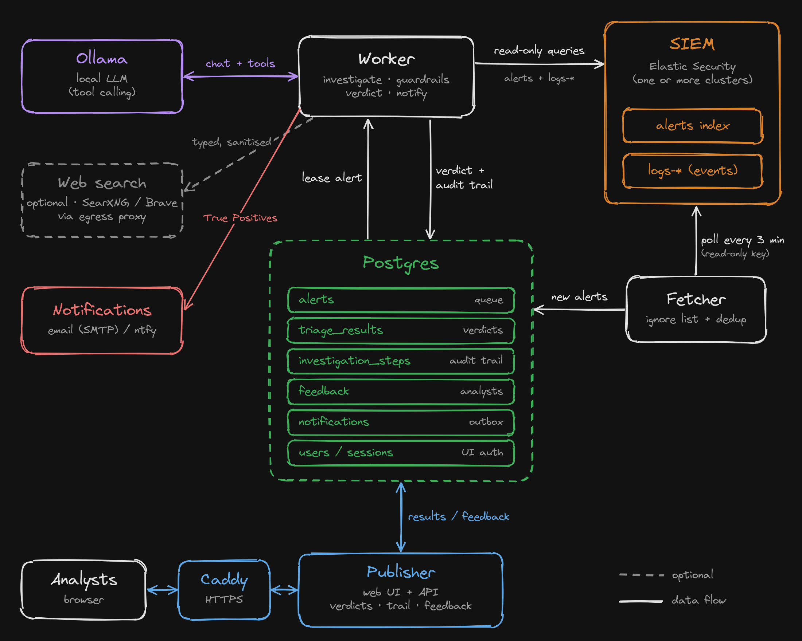

# Ardea

**AI triage for Elastic Security that runs on your own hardware. No alert data leaves your network.**

Website: [ardeasecurity.com](https://ardeasecurity.com) · Support: support@ardeasecurity.com

Ardea pulls new Elastic Security detection alerts, has a local LLM (in Ollama) investigate each one with
read-only SIEM queries, and publishes a verdict with the evidence behind it in a web UI:

- **True Positive**: malicious or unauthorised activity, supported by evidence
- **Benign Positive**: the rule fired correctly on legitimate activity
- **False Positive**: the rule misfired
- **Needs Human Review**: evidence is missing or contradictory, or the impact is too high to close automatically

Every verdict cites the log events it is based on, and the full investigation trail is kept. Guardrails in
code, not in the prompt, decide what may be closed automatically: high-impact tactics such as credential
access, suspected prompt injection and thin evidence always go to a person.


## Try the demo (2 minutes, no SIEM needed)

```bash
git clone https://github.com/GikaBites/ardea.git && cd ardea
docker compose -f docker-compose.demo.yml up -d --build
```

Open https://localhost:8443, accept the browser warning (a certificate made on your computer) and sign in
as `demo` / `demo`. The demo holds about eight weeks of sample alerts and five example investigations (written by hand to show the UI), with all
paid features switched on. It needs no Elastic and no Ollama, and it is reachable only from your computer.
Remove it with `docker compose -f docker-compose.demo.yml down -v`.

## How it works



[REVIEW.md](REVIEW.md) describes how Ardea works in detail.

---

## Editions

Ardea is free to use. The paid editions add convenience features; they never change how alerts are
triaged.

| | Community (free) | Pro | MSP |
|---|:---:|:---:|:---:|
| LLM investigation, all guardrails, closure review, prompt-injection defences | ✓ | ✓ | ✓ |
| Web UI with users, roles, audit trail and analyst feedback | ✓ | ✓ | ✓ |
| Web search with the outbound sanitiser | ✓ | ✓ | ✓ |
| Collect from one Elastic cluster | ✓ | ✓ | ✓ |
| [Reports and insights](#reports-and-insights): management report (print / PDF), weekly trends, scheduled report e-mails | | ✓ | ✓ |
| [Rule-tuning advisor](#rule-tuning-advisor): ready-to-paste Elastic exceptions for patterns that are always harmless | | ✓ | ✓ |
| [Integrations](#integrations): Slack, Microsoft Teams, webhook, Jira, TheHive, plus e-mail and ntfy | | ✓ | ✓ |
| [Playbook pack](#playbook-pack): ready-made playbooks for 30 noisy Elastic prebuilt rules, updated monthly | | ✓ | ✓ |
| [Single sign-on](#single-sign-on) through your identity provider | | ✓ | ✓ |
| Re-triage button, CSV export, eval-case export | | ✓ | ✓ |
| [Several Elastic clusters](#several-siems) with per-user SIEM access | | | ✓ |
| [Per-customer setup](#per-customer-setup-msp): own alert routing, monthly reports, facts and playbooks per customer | | | ✓ |
| Customer portal (read-only logins per customer), usage export for billing | | | ✓ |
| Run Ardea for your customers, [your own branding](#own-branding) | | | ✓ |

**Pro and MSP open for purchase soon** at [ardeasecurity.com](https://ardeasecurity.com/#pricing). Until then, the
Community edition is free and complete for one cluster; for early access to the paid features, write to
support@ardeasecurity.com.

**Safety is the same in every edition.** A missing, expired or unreachable licence never stops triage and
never weakens a guardrail: Ardea falls back to Community, keeps every per-user restriction, and alerts
already queued are still triaged. If the licence server cannot be reached, the paid features stay on for
30 days.

**Activating a licence.** As an admin, paste the key from your purchase e-mail under **Settings → Licence** and
click **Check the licence now**. (Or put it in `.env` as `ARDEA_LICENSE_KEY` and run `docker compose up -d worker`.) Check it with `docker compose exec worker python licensing.py`; admins also
see the edition on the **Users** page. The worker contacts `api.lemonsqueezy.com` once a day with only the
key and an installation name, never alert data. With the egress lockdown, start the `egress` profile and set
`ARDEA_LICENSE_PROXY=http://egress-proxy:3128`. For a network without internet access, ask for an
offline licence file and put it in `license/ardea.license`.

---

## Requirements

| Component | Notes |
|---|---|
| Docker host | Linux with Docker Engine and Docker Compose v2. 2 CPU cores, 4 GB RAM and 10 GB of disk are enough for Ardea itself. |
| Elastic Security | Detection rules writing alerts to `.alerts-security.alerts-default`, and endpoint/Windows events in `logs-*` (Elastic Defend, or Sysmon via Elastic Agent). |
| Ollama | On the Docker host or another machine on the LAN, with a model that supports tool calling. |

**Choosing a model.** `qwen3:30b-a3b-instruct-2507-q4_K_M` is the recommended default. It is a mixture-of-experts
model with only 3B active parameters, so it runs acceptably even without a GPU: on 2× Xeon Gold 6126 it reads
about 85 tokens/s and writes about 9 tokens/s, which is roughly 3 minutes per alert. It needs about 20 GB of RAM
or VRAM. With a 12–16 GB GPU, `qwen3:14b` is faster. Avoid models below 8B parameters or below Q4 quantisation.

---

## Installation

### 1. Install Ollama and pull the model

On the machine that will run the model:

```bash
curl -fsSL https://ollama.com/install.sh | sh
# Arch Linux: sudo pacman -S ollama   (or ollama-cuda / ollama-rocm for your GPU)
ollama pull qwen3:30b-a3b-instruct-2507-q4_K_M
```

If Ollama runs on a different machine from Ardea, make it listen on the network and keep the model loaded.
Run `sudo systemctl edit ollama` and add:

```ini
[Service]
Environment="OLLAMA_HOST=0.0.0.0:11434"
Environment="OLLAMA_KEEP_ALIVE=-1"
Environment="OLLAMA_NUM_PARALLEL=1"
Environment="OLLAMA_MAX_LOADED_MODELS=1"
```

Restart it with `sudo systemctl restart ollama`, then check from the Ardea host:

```bash
curl http://<ollama-host>:11434/api/tags
```

Ollama has no authentication, so allow only the Ardea host to reach port 11434.

### 2. Create two read-only Elastic API keys

[`elastic/roles.json`](elastic/roles.json) defines two keys:

- **fetcher**: reads the alerts index only
- **worker**: reads alerts and `logs-*`, with password and token fields hidden

Neither key can write anything. In Kibana → **Dev Tools**, create each key using its block from the file as the
request body:

```
POST /_security/api_key
{
  "name": "ardea-fetcher",
  "expiration": "180d",
  "role_descriptors": { ... copy from elastic/roles.json ... }
}
```

Keep the `encoded` value from each response for the next step. The keys expire after 180 days, so set a reminder
to renew them.

### 3. Get the code and configure it

```bash
git clone https://github.com/GikaBites/ardea.git
cd ardea
cp .env.example .env
chmod 600 .env
```

In `.env` you only need **`POSTGRES_PASSWORD`** (a long random password) and the HTTPS address of step 4.
Everything else (the AI model, your SIEMs, notifications, the licence) can be set after the first sign-in on
the **Settings** page of the web UI (step 6).

If you prefer to keep everything in files, every setting is documented in [`.env.example`](.env.example) and
still works: a value in `.env` always wins and is shown read-only on the Settings page. The ones that matter most:

| Setting | Value |
|---|---|
| `LLM_URL` | `http://<ollama-host>:11434`, or `http://host.docker.internal:11434` if Ollama runs on the Docker host |
| `LLM_MODEL` | The model you pulled, exactly as `ollama list` shows it |
| `LLM_NUM_CTX` | `16384` without a GPU, `24576` with one |
| `ELASTIC_URL` | e.g. `https://elastic.example.com:9200` |
| `ELASTIC_FETCHER_API_KEY`, `ELASTIC_WORKER_API_KEY` | The two `encoded` values from step 2 |
| `ELASTIC_CA_CERT` | Only if Elasticsearch uses a private CA: the path to the CA file inside the containers |
| `KIBANA_BASE_URL` | e.g. `https://kibana.example.com`. The UI only links to this host. |
| `INTERNAL_DOMAINS` | Your internal DNS suffixes and AD domain |

Put comments in `.env` on their own line, never after a value: Docker Compose would read the comment as part of
the value.

With more than one Elastic cluster, add them on the Settings page, or leave the `ELASTIC_*` settings empty and use
`siems/siems.json` (see [Several SIEMs](#several-siems)).

### Several SIEMs

*MSP edition. Other editions collect only from the first SIEM in `siems.json`.*

Ardea can collect alerts from several Elastic clusters (for example one per site or per customer). Each alert is
investigated only in the cluster it came from, and the UI can show one SIEM or all of them.

1. Create the two read-only API keys of step 2 **in every cluster**.
2. Copy the example and fill in one entry per cluster:

   ```bash
   cp siems/siems.example.json siems/siems.json
   sudo chown 10001 siems/siems.json && sudo chmod 600 siems/siems.json   # the containers run as uid 10001
   ```

   | Field | Value |
   |---|---|
   | `id` | Short, stable id: lowercase letters, digits, `-`, `_`. It is stored with every alert, so don't rename it. |
   | `name` | Shown in the UI and in notifications |
   | `url` | Elasticsearch URL, e.g. `https://elastic-hq.example.com:9200` |
   | `fetcher_api_key`, `worker_api_key` | The two `encoded` keys of that cluster |
   | `kibana_url` | That cluster's Kibana. Links in the UI and notifications only go to this host. |
   | `ca_cert` | Optional. A private CA: put the file in `siems/` and write `/app/siems/<file>` |
   | `alerts_index`, `events_indices` | Optional. Defaults: `.alerts-security.alerts-default` and `logs-*` |
   | `enabled` | Optional. `false` stops collecting from that cluster |

3. `docker compose up -d --build`. The fetcher log lists the SIEMs it polls.

The Settings page does the same without a file (**Settings → SIEMs → Add a SIEM**). When `siems/siems.json`
exists, it wins: the SIEM list on the Settings page becomes read-only, and the `ELASTIC_*`, `KIBANA_BASE_URL` and
`SIEM_NAME` settings in `.env` are ignored.
Alerts collected before this file existed belong to the **first** SIEM in it, so put the cluster you used until now
first. `siems/siems.json` and certificates in `siems/` are git-ignored: they contain secrets.

Same host names in two SIEMs are treated as different machines: duplicates are only merged, and "same host" analyst
feedback is only reused, within one SIEM.

### 4. Set up HTTPS for the web UI

The UI is served over HTTPS by a Caddy container; plain HTTP on port 80 only redirects to HTTPS. In `.env`, list
every name and address users will type in the browser:

```ini
ARDEA_SITE_ADDRESS=ardea.example.com, 192.168.1.20
ARDEA_DEFAULT_SNI=192.168.1.20
```

`ARDEA_DEFAULT_SNI` is needed when users open Ardea by IP address: browsers do not send a host name for an
IP, so Caddy uses this entry to pick the certificate.

**Certificate.** By default (`ARDEA_TLS=internal`) Caddy creates its own certificate authority and a
certificate for those names. Browsers trust it once its root certificate is installed on the analysts' machines
(Windows: *Trusted Root Certification Authorities*, or deploy it by Group Policy). After the first start:

```bash
docker compose cp caddy:/data/caddy/pki/authorities/local/root.crt ./ardea-root-ca.crt
```

To use a certificate from your own CA instead, put `ardea.crt` (with the chain) and `ardea.key` in
`caddy/certs/` and set `ARDEA_TLS=/certs/ardea.crt /certs/ardea.key`. With a certificate that browsers
already trust, you can also set `ARDEA_HSTS_SECONDS=31536000`.

If ports 80 or 443 are already used on the host, change `ARDEA_HTTP_BIND` / `ARDEA_HTTPS_BIND`.

### 5. Start Ardea and sign in

```bash
docker compose up -d
docker compose ps                      # all containers should become "healthy"
docker compose logs -f worker          # look for "worker ... running, model=..."
```

The database is created on the first start. The fetcher first picks up the alerts of the last 12 hours, then
polls every 3 minutes (`FETCH_INTERVAL_SECONDS`).

On its first start the UI creates the user **admin** with a random one-time password, written once to the
publisher's log:

```bash
docker compose logs publisher | grep -A1 "Temporary password"
```

Open `https://<host>/`, sign in as `admin` with that password, and choose your own password (at least 12
characters). Then open **Settings** (step 6) and create accounts for the other analysts under **Users** (see [Users and roles](#users-and-roles)).

### 6. Configure Ardea on the Settings page

Signed in as an admin, open **Settings**. Changes apply within about 30 seconds, without a restart.

| Section | What you set there |
|---|---|
| Licence | Your Pro or MSP licence key, or an offline licence file |
| SIEMs | Each Elastic cluster: URL, the two API keys of step 2, Kibana URL, a private CA certificate. MSP: per-customer facts, alert routing and report recipients |
| AI model | Ollama URL, model, context window, reasoning, timeouts. **Test the connection** lists the installed models |
| Triage | Confidence needed to close, the second look before closing, investigation limits, rules to ignore |
| Web search | Provider and keys, allowed query kinds, internal domains and words that must never be searched |
| Notifications | E-mail, ntfy, Slack, Teams, webhook, Jira, TheHive, with a test button for each (Pro) |
| Reports and branding | Scheduled report e-mails (Pro), minutes per alert for the time-saved estimate, your brand name and logo (MSP) |
| Change log | Who changed which setting and when. Values are never recorded |

How the Settings page keeps secrets safe:

- **Write-only.** A saved key or password is shown only as "Saved (ends in 7f3a)". Nobody can read it back,
  admins included.
- **The web UI cannot open them.** Secrets are encrypted with a key pair that the worker creates on its first
  start. Only the worker and fetcher hold the private half (Docker volume `settings_keys`); the web UI has only the
  public half. Someone who took over the web UI could still not read your Elastic keys or SMTP password.
- **Bound to their host.** An Elastic API key only opens for the cluster URL it was saved with, and the SMTP
  password only for its SMTP server. Changing the address clears the secret, so it can never be sent somewhere new
  without being typed in again.
- **Tests run in the worker.** The test buttons queue a check that the worker carries out with the saved values;
  results never contain the secret or a full URL. They can take a minute while the worker investigates an alert.
- **Your password again.** Saving a key, password, the licence or a SIEM asks for the admin's password (not with
  single sign-on). Wrong answers count towards the normal lockout.

What stays in `.env`: database credentials, the HTTPS address and certificate, single sign-on, the egress proxy,
web UI session limits and demo mode. A value set in `.env` always wins and appears read-only on the Settings page;
remove it from `.env` to manage it there.

**Back up the `settings_keys` volume** together with the database. Without it, the worker creates a new key and the
Settings page asks you to enter the saved keys and passwords again (nothing else is lost).

### 7. Tune it for your environment

- **Playbooks**: [`worker/playbooks.yaml`](worker/playbooks.yaml) holds rule-specific guidance and the SIEM queries
  that run before the LLM starts. Write playbooks for your noisiest rules first. Changes are picked up
  automatically.
- **Environment facts**: the `context:` list at the end of `playbooks.yaml`, e.g. where backup scripts live, how
  service accounts are named, which subnet the vulnerability scanner uses. The model relies on these, so add only
  verified facts.
- **Ignored rules**: [`fetcher/ignored_rules.json`](fetcher/ignored_rules.json) lists rules that are never sent to
  triage (`ignored` = exact rule names, `match` = parts of names). Apply changes with
  `docker compose up -d --build fetcher`.

---

## Using Ardea

The **Alerts** page has three parts:

- **Verdict tiles** with live counts: all alerts, True Positive, Needs Review, Benign Positive, False Positive and
  alerts to escalate. Click a tile to show only those alerts; click it again to show all.
- **Filters**: free-text search (press `/` to jump to it), time range (24 hours, 7 days, 30 days, all), verdict,
  severity and escalation chips (click to show only, Shift+click to hide), sorting (newest, highest severity,
  highest confidence), a **SIEM** selector (all SIEMs or one; shown when there is more than one) and, under
  *More filters*, a confidence range. The address bar keeps the filters, so a
  bookmark or shared link opens the same view.
- **The alert list**: one row per alert with verdict, severity, rule, host, confidence, merged duplicates, an
  escalation flag, the time and a one-line summary. New alerts appear at the top as they are triaged.

Click an alert to open it: summary, key findings with the evidence they rely on, the best malicious and benign
explanations, recommended actions, information gaps, MITRE ATT&CK techniques, safety checks that changed the
verdict, a link to Kibana and the alert ID (click to copy). **Investigation trail** shows every step: each query
with its arguments and result, and every model turn.

Analysts and admins can use the 👍 / 👎 buttons, and pick the correct verdict on 👎. Feedback is shown to the model when similar alerts
come in later. If an analyst marked a similar alert True Positive, the new one is never closed automatically.

### Users and roles

| Role | Can |
|---|---|
| **Viewer** | See alerts, verdicts and investigation trails. |
| **Analyst** | Everything a viewer can, plus give feedback on verdicts (👍 / 👎). |
| **Admin** | Everything an analyst can, plus manage users. |

Admins manage accounts on the **Users** page: create a user (with a generated one-time password that is shown
once), change a role, reset a password, disable, enable or delete an account. Every new or reset account must
choose its own password at its next sign-in, and a role change, reset or disable signs that user out everywhere.
Ardea always keeps at least one active admin, and admins cannot change, disable or delete their own account.
The same page shows recent account activity: sign-ins, failed attempts, lockouts and changes.

**SIEM access** (with [several SIEMs](#several-siems)): when you create a user, tick *All SIEMs* or only the SIEMs
they may see; change it later in the *SIEMs* column. A user sees only those SIEMs' alerts, counts, investigation
trails and SIEM filter, and can give feedback only on them. *All SIEMs* includes SIEMs added later; admins always
see every SIEM. Changing a user's SIEMs signs them out. Notifications (email / ntfy) are not filtered per user: they
go to the addresses in `.env`.

Sign-in protection:

- passwords are stored as scrypt hashes and must be at least 12 characters, without the username
- after 5 wrong passwords an account is locked for 15 minutes (`MAX_FAILED_LOGINS`, `LOCKOUT_MINUTES`)
- sessions end after 8 hours without activity and always after 24 hours (`SESSION_IDLE_MINUTES`,
  `SESSION_MAX_HOURS`); signing out ends the session on the server
- session cookies are HTTPS-only and not readable by scripts, and every change requires a per-session token

If nobody can sign in as an admin any more, reset a password from the server:

```bash
docker compose exec publisher python manage.py list-users
docker compose exec publisher python manage.py reset-password admin     # prints a new one-time password
```

### Inspecting the database

To inspect the queue and results:

```bash
docker exec -it Ardea_postgres psql -U <POSTGRES_USER> -d <POSTGRES_DB>
```
```sql
SELECT status, count(*) FROM alerts GROUP BY 1;            -- new / processing / retry / done / failed
SELECT verdict, count(*) FROM triage_results GROUP BY 1;
SELECT alert_id, last_error FROM alerts WHERE status = 'failed' ORDER BY timestamp DESC LIMIT 20;
```

An alert is never dropped. After 3 failed attempts it is published as *Needs Human Review* with the reason. If
Ollama is unreachable, alerts wait in the queue until it is back.

---

## True Positive notifications

*Pro and MSP editions.*

Notifications are off until `NOTIFY_CHANNELS` is set. Each one is saved together with the verdict and delivered
with retries (from 30 s up to 1 h apart, 8 attempts), so a mail outage delays a notification but cannot lose it.
Only verdicts stored after you turn notifications on are sent.

1. **Choose the channels**: `smtp` (plain-text email), `ntfy` (push notifications to your phone), or both. A
   self-hosted ntfy server keeps alert details on your network. With Microsoft 365, enable *Authenticated SMTP*
   for the sending mailbox (Exchange admin center → the mailbox → *Manage email apps*).
2. **Add the settings to `.env`:**
   ```ini
   NOTIFY_CHANNELS=smtp
   ARDEA_PUBLIC_URL=https://ardea.example.com
   SMTP_HOST=smtp.office365.com
   SMTP_PORT=587
   SMTP_SECURITY=starttls
   SMTP_USER=ardea@example.com
   SMTP_PASSWORD='the-password'
   SMTP_FROM=ardea@example.com
   SMTP_TO=soc@example.com,oncall@example.com
   ```
   For ntfy, add `ntfy` to `NOTIFY_CHANNELS` and set `NTFY_URL`, `NTFY_TOPIC` and, if your server uses access
   tokens, `NTFY_TOKEN`. On the public ntfy.sh, anyone who knows the topic name can read it, so make it long and
   random. High and Critical alerts are sent at the highest priority.
3. **Restart the worker and send a test message:**
   ```bash
   docker compose up -d worker
   docker compose exec worker python notifier.py          # prints "sent test via smtp"
   ```
4. **Check delivery** from time to time:
   ```sql
   SELECT status, count(*), max(last_error) FROM notifications GROUP BY 1;
   ```
   `pending` with an error is still being retried; `failed` has given up. After fixing the cause, resend them with
   `UPDATE notifications SET status='pending', attempts=0, next_attempt_at=NOW() WHERE status='failed';`

More options:

- `NOTIFY_VERDICTS=True Positive,Needs Human Review` together with `NOTIFY_MIN_SEVERITY=High` also reports serious
  alerts the model could not confirm. On CPU-only setups, many real attacks end up as *Needs Human Review*.
- `NOTIFY_DETAIL=minimal` sends only the verdict, severity, rule name and links, without hostnames, users or the
  summary. Use it when mail goes through a cloud provider.

---

## Reports and insights

*Pro and MSP editions.* Open **Insights** in the top menu.

- **Report**: for the last 7, 30 or 90 days or any month: alerts triaged, closed automatically, sent to a
  person, true positives (listed), analyst time saved, analyst agreement and how often closures were right,
  and the noisiest rules. **Print or save as PDF** gives a clean one-page report for management.
- **Trends**: verdicts per week for the last 12 weeks, analyst agreement and median time per alert.
- **Scheduled e-mails**: set `ARDEA_REPORTS=weekly` or `monthly` (and optionally `ARDEA_REPORT_TO`). The
  worker e-mails the key figures and a link to the full report on Monday or on the 1st, through your SMTP
  settings. Each report is sent once.

"Time saved" is an estimate: alerts closed automatically × `ARDEA_MINUTES_PER_ALERT` (default 10). Set it to
what a first look at an alert takes your analysts. Users restricted to some SIEMs only see those SIEMs'
figures.

### Rule-tuning advisor

*Insights → Rule tuning*, for analysts and admins. It lists alert patterns from the last 30 days (same rule,
program, parent program and account) that Ardea closed every time, at least 5 times, and no analyst disputed.
For each one it writes the matching Elastic **rule exception**, as a query and as JSON for the exceptions API.
Add it in Kibana → Security → Rules → the rule → Rule exceptions. Patterns of credential access, lateral
movement, impact and exfiltration rules, and any pattern that ever had a true positive or a review verdict,
are never suggested. Check each suggestion before adding it: an exception stops the rule from alerting on
that pattern.

Only alerts collected by this version have the process details the advisor needs.

---

## Integrations

*Pro and MSP editions.* Add the channels you use to `NOTIFY_CHANNELS` (comma list) and fill in their settings
in `.env`. They use the same rules as e-mail: `NOTIFY_VERDICTS`, `NOTIFY_MIN_SEVERITY` and `NOTIFY_DETAIL`, and
every message is queued and retried.

| Channel | Settings | What arrives |
|---|---|---|
| `slack` | `SLACK_WEBHOOK_URL` (incoming webhook) | Message with the verdict and buttons to Ardea and Kibana |
| `teams` | `TEAMS_WEBHOOK_URL` (Workflows: *when a webhook request is received*, post a card) | Adaptive card |
| `webhook` | `WEBHOOK_URL`, optional `WEBHOOK_SECRET` | JSON `{"event": "ardea.verdict", "payload": {...}}`, signed with `X-Ardea-Signature: sha256=<HMAC>` |
| `jira` | `JIRA_URL`, `JIRA_USER`, `JIRA_API_TOKEN`, `JIRA_PROJECT`, `JIRA_ISSUE_TYPE` | One issue per verdict, labelled `ardea` |
| `thehive` | `THEHIVE_URL`, `THEHIVE_API_KEY` | One TheHive 5 alert per verdict (never twice for the same alert) |

Test them with `docker compose exec worker python notifier.py` (all configured channels) or
`... python notifier.py slack`. Alert text is untrusted, so it is escaped for each channel: it cannot create
links or mentions in Slack or Teams. With the egress lockdown, set `NOTIFY_PROXY=http://egress-proxy:3128` and
add the hosts you use (for example `hooks.slack.com`) to `egress-proxy/squid.conf`.

---

## Playbook pack

*Pro and MSP editions.*

The playbook pack adds ready-made playbooks (pre-collected evidence plus guidance on what is benign and what
is not) for 30 common, noisy Elastic prebuilt rules, such as *Suspicious MS Office Child Process*,
*Startup or Run Key Registry Modification*, *Svchost spawning Cmd* and *Whoami Process Activity*, plus
guidance per MITRE tactic. Download the newest `ardea-playbooks-<version>.ardpack` from your order and
put it in `packs/`. The worker loads it within a minute; the worker log shows `playbook pack ... loaded`.

The pack is signed: a modified pack is refused, because playbook text is shown to the model as trusted
guidance. Your own `worker/playbooks.yaml` always wins over the pack for the same rule or tactic, so you can
copy any playbook from the pack there and adapt it. Rule policies such as *Credential Access is never
closed automatically* in your file cannot be relaxed by the pack.

---

## Single sign-on

*Pro and MSP editions.*

Analysts can sign in through your identity provider (Authentik, Authelia, Keycloak with oauth2-proxy, ...)
instead of an Ardea password. Caddy asks the identity provider (`forward_auth`) and passes the username to
Ardea, which signs in the Ardea user with **exactly that username**. Accounts are not created
automatically: create each user on the **Users** page first, so you still decide who gets in and with which
role.

1. Uncomment the `forward_auth` block in [`caddy/Caddyfile`](caddy/Caddyfile) and point it at your identity
   provider. The header must arrive as `X-Ardea-User`; Caddy always removes that header from browser
   requests first, so it cannot be forged.
2. Set `ARDEA_SSO=true` in `.env` and run `docker compose up -d`.

Local passwords keep working as a fallback (for example while the identity provider is down). Signing out of
Ardea signs you straight back in while your identity provider session lasts; sign out there to end it.

---

## Per-customer setup (MSP)

*MSP edition.* Each SIEM in `siems/siems.json` can carry its own settings:

```json
{"id": "acme", "name": "Acme Ltd", "url": "...", "fetcher_api_key": "...", "worker_api_key": "...",
 "context": ["Acme backups run nightly as svc.acmebackup", "10.9.0.5 is Acme's vulnerability scanner"],
 "notify": {"smtp_to": ["soc@acme.example"], "slack_webhook_url": "https://hooks.slack.com/services/...",
            "teams_webhook_url": "", "webhook_url": "", "webhook_secret": ""},
 "report_to": ["it-manager@acme.example"]}
```

- **`context`**: environment facts the model uses only for this customer's alerts.
- **`siems/<id>.playbooks.yaml`**: playbooks for this customer only (same layout as `worker/playbooks.yaml`).
  They win over your general playbooks and the pack. A tactic you marked `never_auto_close` stays so.
- **`notify`**: this customer's verdicts also go to their own e-mail, Slack, Teams or webhook, in addition to
  your channels.
- **`report_to`**: with `ARDEA_REPORTS` set, this customer gets their own report e-mail, with only their
  alerts and under your brand name.
- **Customer portal**: create **viewer** accounts limited to the customer's SIEM (Users page). They see only
  their own alerts and their own Insights report.
- **Usage export**: Users page → `/admin/usage.csv?month=2026-11` gives alerts per customer per month, for
  your invoicing.

---

## Own branding

*MSP edition.* Set `ARDEA_BRAND_NAME` in `.env` and put your logo in `branding/` as `logo.png`, `logo.jpg`
or `logo.webp` (at most 512 KB; SVG is not accepted). Then run `docker compose up -d publisher`.

---

## Web search (optional)

Web search lets the model look up public indicators: IP and domain reputation, file hashes, CVEs, MITRE
techniques and well-known file names. It is the only feature that sends data to the internet, so it is off by
default and protected in several layers:

- the model cannot write free-text queries, only typed indicators, and every query is checked in code: hostnames,
  usernames, internal IPs and domains, paths, e-mail addresses and secrets are rejected
- results are reduced to titles and short snippets (pages are never opened) and are marked as untrusted data
- every query is logged in the `outbound_requests` table, with hourly and daily limits

### With SearXNG (free)

SearXNG is a self-hosted search engine that forwards queries to DuckDuckGo, Bing, Brave and Wikipedia
([`searxng/settings.yml`](searxng/settings.yml)). It is included as the optional `search` profile and has no
published port, so only the worker can use it.

1. **List what must never leave your network** in `.env`. Any query containing one of these is rejected:
   ```ini
   INTERNAL_DOMAINS=example.com,example.local,corp
   SENSITIVE_TERMS=example,<AD NetBIOS name>,<Microsoft 365 tenant name>,<customer names>,<project names>
   ```
2. **Turn on SearXNG in dry-run mode.** Queries are checked and logged, but nothing is sent:
   ```ini
   COMPOSE_PROFILES=search
   WEB_SEARCH_PROVIDER=searxng
   SEARXNG_URL=http://searxng:8080
   SEARXNG_SECRET=<output of: openssl rand -hex 32>
   WEB_SEARCH_DRY_RUN=true
   WEB_SEARCH_KINDS=ip,domain,hash,cve,mitre,filename
   ```
   ```bash
   docker compose up -d
   docker compose exec worker python -c "import websearch; print(websearch.search('MITRE ATT&CK T1202', 3)['result_count'])"
   ```
   The second command sends one generic test query to check that SearXNG works. It should print a number above 0.
3. **Review the logged queries for about a week:**
   ```sql
   SELECT created_at, alert_id, query FROM outbound_requests WHERE status = 'dry_run' ORDER BY created_at DESC;
   ```
   Add anything that identifies your organisation to `SENSITIVE_TERMS`, then run `docker compose up -d worker`.
4. **Block direct internet access from the worker** (below), then set `WEB_SEARCH_DRY_RUN=false` and run
   `docker compose up -d worker`.

The free-text kinds `command_pattern` and `error_text` are off by default. Add them to `WEB_SEARCH_KINDS` only after
a dry run with them shows clean queries.

### With the Brave Search API

Brave has its own index and a single API host, which is simpler to firewall. Get a key at
https://api-dashboard.search.brave.com, then set `WEB_SEARCH_PROVIDER=brave`, `BRAVE_API_KEY=...` and
`EGRESS_PROXY=http://egress-proxy:3128`, and add `egress` to `COMPOSE_PROFILES`. The bundled squid proxy
([`egress-proxy/squid.conf`](egress-proxy/squid.conf)) only allows HTTPS to `api.search.brave.com`.

### Blocking direct internet access

Docker containers can reach the internet by default. [`egress-proxy/firewall.sh`](egress-proxy/firewall.sh)
restricts the `lan` network (worker and fetcher) to Elasticsearch, Ollama and your mail server, and rejects
everything else. Web search then only works through SearXNG or the squid proxy. Run it as root on the Docker host
with IP addresses, not host names:

```bash
sudo ELASTIC=10.0.0.5:9200 OLLAMA=10.0.0.11:11434 SMTP=10.0.0.25:587 ./egress-proxy/firewall.sh
docker compose exec worker python -c "import requests; requests.get('https://example.com', timeout=5)"   # must fail
```

Docker recreates its firewall chain when it restarts, so run the script from a systemd unit with
`After=docker.service`. `sudo ./egress-proxy/firewall.sh --remove` removes the rules.

The `lan` and `egress` networks use `172.30.10.0/24` and `172.30.20.0/24`. If these clash with your network, change
`ARDEA_LAN_SUBNET` and `ARDEA_EGRESS_SUBNET` before the first start.

---

## Performance without a GPU

- Writing the verdict is the slowest part (600–900 tokens). Keep the ignore list and playbooks focused, so the
  model spends its time on alerts that matter.
- Keep `LLM_NUM_CTX` at `16384`. A larger context makes every prompt slower, and changing it reloads the model.
- On a server with two CPU sockets, compare `LLM_NUM_THREAD=12` and `24` (physical cores of one socket vs. both)
  with the evaluation below and keep the faster setting.
- On the Ollama server, `OLLAMA_FLASH_ATTENTION=1` and `OLLAMA_KV_CACHE_TYPE=q8_0` may help. Measure before
  keeping them.
- `VERIFY_CLOSURES=true` adds a short second check (10–20 s) before an alert is closed as False or Benign
  Positive. It catches wrong closures; turn it off only if Ardea cannot keep up with your alert volume.

---

## Testing and evaluation

The worker tests need no model, database or SIEM:

```bash
python3 -m venv .venv && . .venv/bin/activate
pip install -r worker/requirements.txt pytest
pytest eval/ -q
```

The web UI tests (sign-in, roles, sessions, user management) run against a real, empty Postgres database whose
name ends in `_test`, after loading `db/init.sql` into it:

```bash
pip install -r publisher/requirements.txt pytest
POSTGRES_HOST=... POSTGRES_USER=... POSTGRES_PASSWORD=... POSTGRES_DB=ardea_test pytest publisher/tests -q
POSTGRES_HOST=... POSTGRES_USER=... POSTGRES_PASSWORD=... POSTGRES_DB=ardea_test pytest eval/test_licensing_db.py -q
```

The evaluation runs labelled alerts through the real model, with recorded SIEM results, and reports accuracy,
missed true positives, auto-close precision and prompt-injection failures:

```bash
python eval/run_eval.py --cases eval/samples/cases --llm http://<ollama-host>:11434 --model <model>
```

Once analysts have given feedback in the UI, build an evaluation set from your own alerts (Pro and MSP):

```bash
docker compose exec worker python export_eval_cases.py --out /tmp/cases
docker cp Ardea_worker:/tmp/cases/. eval/cases/          # git-ignored: contains real alert data
python eval/run_eval.py --llm http://<ollama-host>:11434 --model <model> --out eval/results/baseline.json
```

To measure what the playbook pack changes, add `--packs packs/`. After changing the model, prompts, playbooks or settings, run it again with
`--compare eval/results/baseline.json`. It fails if a true positive is missed or a metric gets worse.

For development with live code changes:
`docker compose -f docker-compose.yml -f docker-compose.dev.yml up`.

---

## Troubleshooting

| Symptom | Cause and fix |
|---|---|
| Worker log: `LLM not reachable ... waiting` | Ollama is down or unreachable. Alerts wait in the queue. Check `curl http://<ollama-host>:11434/api/tags` from the Docker host. |
| Worker log: `model ... is not installed` | `LLM_MODEL` must match `ollama list` exactly. |
| Alerts fail with `SiemError ... permission denied` | The API key expired or lacks index privileges. Recreate it from `elastic/roles.json`. |
| Alerts fail with `SSLError` | Elasticsearch uses a private CA: mount the CA file into the containers and set `ELASTIC_CA_CERT` (one SIEM), or put it in `siems/` and set `ca_cert` (several SIEMs). |
| Fetcher or worker exits with `siems.json ...` | The file is invalid; the message names the entry. `PermissionError`: run `sudo chown 10001 siems/siems.json`. |
| Fetcher log: `[<id>] fetch failed` | That cluster is unreachable or its key is wrong. The other SIEMs keep being collected. |
| Verdict *SIEM '<id>' is no longer configured* | The alert's SIEM was removed from `siems.json` (or disabled) before it was triaged. |
| Each alert takes far longer than a few minutes | Check that Ollama keeps the model loaded (`ollama ps`) and that nothing else uses it at the same time. |
| Browser warns about the certificate | Install Caddy's root certificate on that machine (step 4), or use your own certificate. Check that the address you typed is in `ARDEA_SITE_ADDRESS`. |
| Lost admin password | `docker compose exec publisher python manage.py reset-password admin` |
| "Wrong username or password, or the account is locked" for a correct password | The account is locked after failed attempts (15 minutes) or was disabled; an admin can see it on the Users page and reset it. |
| Worker restarts with `NOTIFY_CHANNELS has unknown channel(s)` | Only `smtp` and `ntfy` are valid. |
| Many *Needs Human Review* verdicts for one rule | Add a playbook and `context:` facts for that rule, and give feedback in the UI. |
| Users page shows *Licence check: licence server not reachable* | The worker cannot reach `api.lemonsqueezy.com`. Paid features stay on for 30 days. Set `ARDEA_LICENSE_PROXY` (egress lockdown) or allow the host. |
| *licence key not accepted: ... activation limit* | The key is active on another installation. Deactivate the old one in the Lemon Squeezy customer portal (link in your order e-mail). |
| Worker log: `playbook pack ... rejected: signature is not valid` | The pack file was changed or damaged. Download it again from your order. |
| SSO: *has no active Ardea account* | Create an Ardea user with exactly the username your identity provider sends, or enable the disabled account. |

---

## Licence

Ardea is source-available under the [Elastic License 2.0](LICENSE): free to use and modify, including in
your company; not to be offered as a hosted or managed service to others, and the licence checks must not be
removed or bypassed. The Pro and MSP editions and the playbook pack are covered by [EULA.md](EULA.md), which
also allows MSPs to run Ardea for their customers. See [NOTICE](NOTICE) for third-party components.

Questions, licences and security reports: support@ardeasecurity.com.
